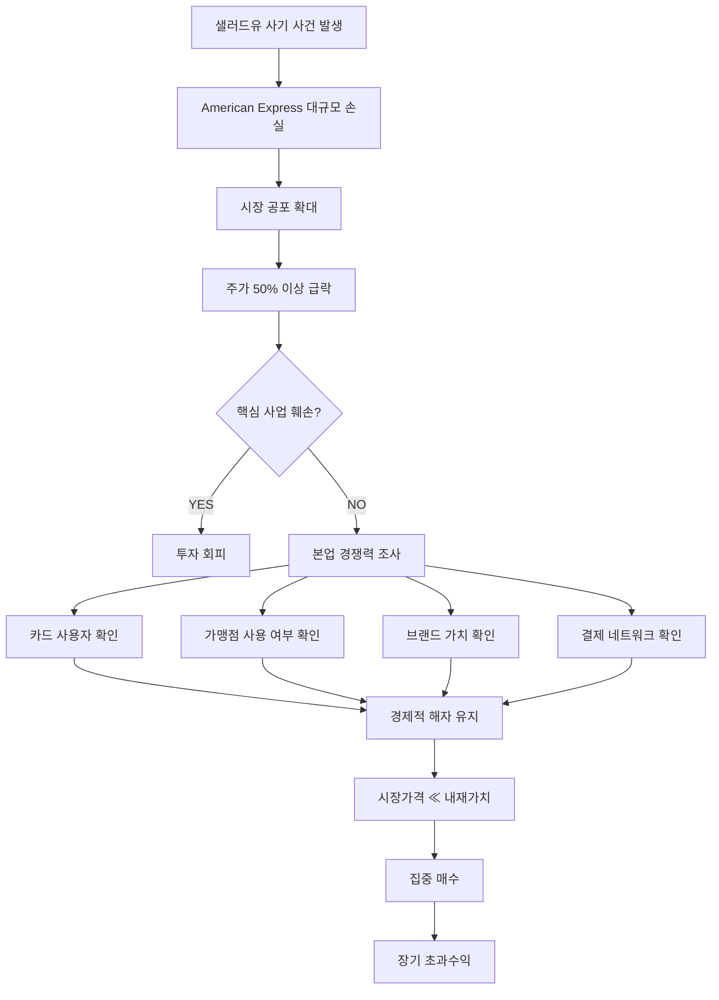

---
{
  "content_hash": "ff058b324c76fa8eb217aa5a4e5d46083ab1ff666f4be8ed45398c88e7a13dbb",
  "created_at": "2026-10-13T05:58:03.099392Z",
  "id": "2ecbde45a7e84f3987b8a8b88d2b7568",
  "tags": [
    "- 투자   - 가치투자   - 워런버핏   - 찰리멍거   - 기업분석   - 투자전략"
  ],
  "title": "\"워런 버핏 투자 철학 - 아메리칸 익스프레스 샐러드유 사건\"",
  "updated_at": "2026-10-13T05:58:03.099392Z"
}
---
---
title: "워런 버핏 투자 철학 - 아메리칸 익스프레스 샐러드유 사건"
tags:
  - 투자
  - 가치투자
  - 워런버핏
  - 찰리멍거
  - 기업분석
  - 투자전략
source: "https://www.youtube.com/watch?v=LXDFJoY5_Y4"
---

# 워런 버핏 투자 철학 - 아메리칸 익스프레스 샐러드유 사건

> **핵심 원칙**
> "평범한 기업을 헐값에 사는 것보다, 훌륭한 기업을 좋은 가격에 사라."

## 1. 핵심 요약

1963년 [[American Express]]는 이른바 **샐러드유 사기(Salad Oil Scandal)**에 연루되면서 대규모 손실과 배상 위험에 직면했다.

시장에서는 이를 기업 전체의 위기로 받아들이면서 주가가 크게 폭락했다.

그러나 [[Warren Buffett]]은 단순히 주가 하락만 보고 투자하지 않았다.

그가 확인한 핵심은 다음과 같았다.

- 사건이 **일회성 손실인지**
- 핵심 사업의 경쟁력이 훼손되었는지
- 고객이 여전히 American Express를 사용하는지
- 브랜드와 결제 네트워크의 가치가 유지되는지

현장 조사를 통해 소비자와 가맹점이 여전히 American Express를 정상적으로 사용하는 것을 확인했고, **사건과 기업의 본질적 경쟁력을 분리해서 판단**했다.

결론적으로 시장이 일시적인 악재를 기업의 장기 가치 훼손으로 과대평가했다고 판단하고 대규모 투자를 실행했다.

---

# 2. 사건 구조



---

# 3. Buffett의 판단 방식

| 구분 | 시장의 판단 | Buffett의 판단 |
|---|---|---|
| 샐러드유 사건 | 기업 전체의 위기 | 일회성 사건 가능성 |
| 대규모 손실 | 파산 위험 | 감당 가능한 손실인지 분석 |
| 주가 폭락 | 추가 하락 가능성 | 가격과 가치의 괴리 |
| 브랜드 | 훼손 우려 | 실제 소비자 행동 확인 |
| 카드 사용 | 불확실 | 정상적으로 지속 |
| 결제 네트워크 | 위험 | 경쟁력 유지 |
| 결론 | 매도 | 매수 기회 |

핵심은 **주가가 많이 떨어졌다는 사실 자체가 아니다.**

> **주가는 폭락했지만 기업의 장기 현금창출 능력은 얼마나 훼손되었는가?**

이 질문이 핵심이다.

---

# 4. Noise와 Signal 분리

## Noise

단기적으로 주가를 크게 움직이지만 장기 기업가치에는 제한적인 영향을 주는 요소.

- 일회성 사고
- 소송
- 특정 사업부 손실
- 단기 실적 쇼크
- 시장 공포
- 언론의 부정적 보도
- 투자자 패닉셀

## Signal

장기 기업가치를 결정하는 요소.

- 고객 수
- 고객 유지율
- 가격 결정력
- 브랜드
- 시장점유율
- 네트워크 효과
- 현금흐름
- ROIC
- 경쟁우위
- 산업 구조
- 장기 성장률

따라서 투자자는 항상 다음을 구분해야 한다.

```text
악재 발생
   ↓
기업의 본질적 경쟁력이 훼손되었는가?
   ↓
 ┌─────────────┐
 YES           NO
 ↓              ↓
가치 하락      가격만 하락
 ↓              ↓
Value Trap     Potential Opportunity
```

---

# 5. Charlie Munger가 Buffett에게 준 영향

초기 Buffett은 [[Benjamin Graham]]의 영향을 받아 **담배꽁초 투자(Cigar Butt Investing)** 전략을 주로 사용했다.

### Graham 방식

```text
평범하거나 나쁜 기업
+
극단적으로 싼 가격
=
투자
```

반면 [[Charlie Munger]]는 기업의 **Quality**를 중요하게 생각했다.

### Munger 방식

```text
Excellent Business
+
Durable Moat
+
Reasonable Price
=
Long-Term Compounder
```

즉,

> **Fair company at a wonderful price**

보다

> **Wonderful company at a fair price**

를 선호한다.

이 사고방식은 이후 Berkshire Hathaway의 투자 철학의 핵심이 된다.

---

# 6. 소액 투자자에게 적용

Buffett은 자본 규모가 작다면 대형주만 보는 것보다 **시장의 관심이 적은 소형주 영역에서 비효율성을 찾을 수 있다**는 취지의 발언을 여러 차례 했다.

자본 규모가 작을수록 투자 가능한 기업의 범위가 넓어진다.

```text
자본 규모 ↓

투자 가능한 기업 수 ↑
소형주 접근 가능 ↑
기관 경쟁 ↓
시장 비효율 ↑

→ 초과수익 기회 증가 가능
```

단, **Small Cap = 저평가**는 아니다.

기업의 질과 가격을 동시에 분석해야 한다.

---

# 7. 내가 실제 투자할 때 적용할 체크리스트

주가가 악재로 급락했을 경우 바로 매수하지 않고 다음 순서로 판단한다.

## Step 1. 악재 분류

- [ ] 일회성 사건인가?
- [ ] 구조적 문제인가?
- [ ] 본업과 직접 관련된 문제인가?
- [ ] 법적 책임 규모를 계산할 수 있는가?
- [ ] 재무적으로 감당 가능한가?

## Step 2. 핵심 사업 확인

- [ ] 매출 성장률 유지
- [ ] 고객 수 유지
- [ ] 시장점유율 유지
- [ ] 가격 결정력 유지
- [ ] 영업이익률 유지
- [ ] FCF 유지
- [ ] ROIC 유지

## Step 3. Moat 확인

- [ ] 브랜드
- [ ] 네트워크 효과
- [ ] 전환 비용
- [ ] 규모의 경제
- [ ] 비용 우위
- [ ] 특허/기술
- [ ] 유통망

## Step 4. 가격 확인

```text
Estimated Intrinsic Value
        ↓
현재 시장가격과 비교
        ↓
Margin of Safety 계산
```

예:

| 내재가치 대비 할인율 | 판단 |
|---:|---|
| 0~10% | 매력 낮음 |
| 10~20% | 관찰 |
| 20~30% | 분할매수 검토 |
| 30~40% | 적극 검토 |
| 40%+ | 원인 재검증 후 강한 후보 |

※ 위 기준은 절대적인 규칙이 아니라 **내 투자 판단용 프레임워크**로 사용한다.

---

# 8. 가장 중요한 교훈

## 가격 하락 ≠ 가치 하락

```text
Price ↓
```

만 보고 매수하면 안 된다.

확인해야 하는 것은

```text
Price ↓↓↓

Intrinsic Value →
```

인지,

```text
Price ↓↓↓

Intrinsic Value ↓↓↓
```

인지다.

전자는 **투자 기회**가 될 수 있지만 후자는 **Value Trap**일 수 있다.

---

# 9. 내 투자 전략과 연결

이 사례에서 가장 활용 가치가 높은 부분은 **폭락 시 무조건 매수하는 것이 아니라 악재의 성격을 먼저 분류하는 것**이다.

특히 장기 투자에서는 다음 구조로 활용할 수 있다.

```text
우량기업 Watchlist
        ↓
평상시 기업가치 분석
        ↓
악재 발생
        ↓
주가 급락
        ↓
Fundamental Damage 분석
        ↓
┌─────────────────────┐
│ 구조적 훼손          │ 일시적 훼손
↓                      ↓
매수 보류/매도          Valuation 재계산
                        ↓
                  Margin of Safety 확보
                        ↓
                     분할매수
```

즉, **평소에 좋은 기업을 미리 분석해 놓고 시장 충격이 왔을 때 행동하는 구조**가 중요하다.

---

# 10. 한 줄 정리

> **좋은 투자 기회는 단순히 주가가 많이 떨어졌을 때가 아니라, 가격은 크게 떨어졌지만 기업의 장기 현금창출 능력과 경제적 해자는 거의 훼손되지 않았을 때 발생한다.**

---

## Related Notes

- [[가치투자]]
- [[경제적 해자 Moat]]
- [[내재가치 Intrinsic Value]]
- [[Margin of Safety]]
- [[역발상 투자]]
- [[시장 비효율성]]
- [[Warren Buffett]]
- [[Charlie Munger]]
- [[Benjamin Graham]]
- [[투자 체크리스트]]

## Source

- YouTube: Warren Buffett / American Express Salad Oil Scandal
- https://www.youtube.com/watch?v=LXDFJoY5_Y4